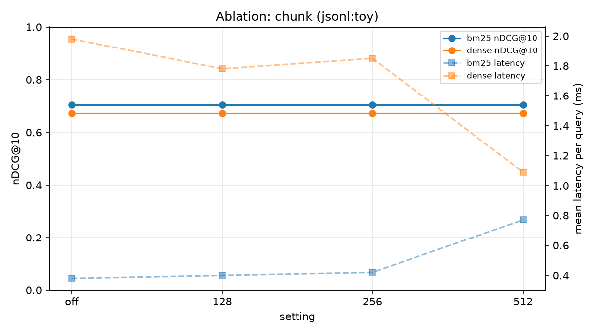

# semantic-search-engine

Lexical, dense, hybrid and reranked retrieval over the same corpus, with an
honest IR evaluation harness: **nDCG@10, Recall@100, MRR@10, MAP@100 and
per-query latency (mean and p95)** for every system, written to CSV, a markdown
table and a chart by one command.

Four systems, one interface:

| # | System | What it is |
|---|---|---|
| 1 | `bm25` | Okapi BM25 over tokenised chunks (`rank_bm25`) |
| 2 | `dense` | `all-MiniLM-L6-v2` bi-encoder + FAISS (`IndexFlatIP` or `IndexIVFPQ`) |
| 3 | `hybrid` | BM25 + dense fused with Reciprocal Rank Fusion (k = 60) |
| 4 | `hybrid+rerank` | the fused top-50 rescored by the `ms-marco-MiniLM-L-6-v2` cross-encoder |

Everything is CPU-only and sized for 8 GB of RAM.

---

## Quickstart (Windows / PowerShell)

```powershell
# from the folder where you extracted the project
cd C:\Users\User\semantic-search-engine

.\scripts\setup.ps1      # creates .venv and installs everything
.\scripts\smoke.ps1      # offline check: tests + end-to-end eval, no downloads
```

`smoke.ps1` runs the whole pipeline on the 12-document corpus in `data/toy/`
using hashed embeddings, so it needs no model download and finishes in seconds.
When it passes, the wiring is correct and you can spend the download budget on
the real run:

```powershell
.\scripts\benchmark.ps1                 # BEIR SciFact (5,183 docs, 300 queries)
.\scripts\benchmark.ps1 beir/nfcorpus   # NFCorpus (3,633 docs, 323 queries)
```

Manual equivalent, if you prefer to drive it yourself:

```powershell
python -m venv .venv
.\.venv\Scripts\Activate.ps1
pip install -e ".[dense,eval,serve,dev]"

semsearch info   --dataset toy
semsearch eval   --dataset beir/scifact
semsearch ablate --dataset beir/scifact --kind chunk
semsearch serve  --dataset beir/scifact --system hybrid     # http://127.0.0.1:8080/docs
semsearch ui     --dataset beir/scifact                     # Streamlit
```

> Python 3.10-3.13. `torch`, which `sentence-transformers` pulls in, has no
> wheels for 3.14 yet - `scripts\setup.ps1` picks 3.12 or 3.11 if you have one.

---

## Results

### Pipeline check (committed, reproduced by CI on every push)

Offline configuration: `configs/experiment.offline.yaml` - 12-document toy
corpus, hashed bag-of-words embeddings instead of a bi-encoder, identity
reranker. These numbers exist to prove the harness runs end to end and that the
metrics agree with `ir_measures` to 4 decimal places; **they say nothing about
retrieval quality on a real corpus.**

| system | nDCG@10 | Recall@100 | MRR@10 | MAP@100 | mean latency (ms) | p95 latency (ms) |
|---|---|---|---|---|---|---|
| bm25 | 0.7041 | 0.6000 | 0.8000 | 0.6000 | 0.26 | 0.49 |
| dense | 0.6711 | 1.0000 | 0.6400 | 0.5017 | 1.47 | 1.63 |
| hybrid | 0.8041 | 1.0000 | 0.8286 | 0.6845 | 1.81 | 2.67 |
| hybrid+rerank | 0.8041 | 1.0000 | 0.8286 | 0.6845 | 1.91 | 2.49 |


Even on 12 documents the shape of the argument is visible: BM25 has the better
top of the ranking (nDCG, MRR), the dense system has the better recall - it
finds every relevant document, just lower down - and fusing them beats both.
With the identity reranker in place of the cross-encoder, `hybrid+rerank` is
`hybrid` by construction, which is exactly what the test suite asserts.

### Benchmark results

`results/` ships only the offline run above. The real numbers are produced on
your machine, because they depend on your hardware for the latency column:

```powershell
.\scripts\benchmark.ps1                        # writes results\beir-scifact_results.{csv,md,png}
```

Paste the generated table into this section when you publish the repo. On a
4-core laptop, SciFact with MiniLM-L6 takes roughly 10-20 minutes for the first
embedding pass (cached afterwards) and the cross-encoder dominates query
latency - expect single-digit milliseconds for BM25, tens for dense, and
hundreds for `hybrid+rerank`.

### Scaling past 100k documents

SciFact and NFCorpus are small on purpose: they make the evaluation loop fast.
For an index above 100k documents use a larger BEIR corpus or your own data:

```powershell
semsearch eval --dataset beir/trec-covid         # 171,332 documents, 50 queries
semsearch eval --dataset jsonl:data/my_corpus    # corpus.jsonl + queries.jsonl + qrels.tsv
```

Budget roughly 1 GB of RAM per 700k MiniLM vectors (384 dims x float32) plus the
BM25 token lists, and switch the dense index to IVF-PQ past a million vectors
(`index_type: ivfpq`, see the index ablation).

### Ablations

| sweep | command | question it answers |
|---|---|---|
| chunk size | `semsearch ablate --kind chunk` | off / 128 / 256 / 512 tokens - does splitting help, and what does it cost in index size and latency? |
| rerank depth | `semsearch ablate --kind topk` | 10 / 25 / 50 / 100 candidates - where does the cross-encoder stop paying for itself? |
| model size | `semsearch ablate --kind model` | MiniLM-L6 (384d) vs MiniLM-L12 vs mpnet-base (768d) |
| index type | `semsearch ablate --kind index` | FAISS flat vs IVF-PQ: recall, latency and vector memory |

Each writes `results/ablations/<kind>.csv` and `<kind>.png`.



---

## The IR concepts, in plain terms

### What nDCG@10 actually measures

```
DCG@k  = sum over ranks i <= k of  rel_i / log2(i + 1)
IDCG@k = the same sum for the best possible ordering of the judgements
nDCG@k = DCG@k / IDCG@k
```

Three properties, each fixing a hole in Precision@k:

1. **Graded.** A document judged "highly relevant" (rel = 2) contributes more
   than one judged "somewhat relevant" (rel = 1). Precision@k treats them the same.
2. **Rank-weighted.** Moving the right answer from rank 5 to rank 1 raises the
   score. Precision@10 does not move at all.
3. **Normalised.** Dividing by the ideal ranking puts a query with 2 relevant
   documents and a query with 50 on the same 0-1 scale, so averaging them is
   meaningful.

The discount is logarithmic rather than linear because attention falls off
steeply with rank but never quite to zero. `nDCG@10 = 1.0` means the ranking is
exactly the ideal one; 0.70 means the right documents are present but ordered
imperfectly.

### Why RRF works

BM25 scores are unbounded sums of IDF terms; cosine similarities live in
[-1, 1]. Adding them mixes incompatible scales, and per-query min-max
normalisation introduces its own distortions. RRF discards the scores and keeps
the ranks:

```
RRF(d) = sum over systems of  1 / (k + rank_system(d)),   k = 60
```

* Scale-free - no normalisation, no blend weight to tune per dataset.
* Rank 1 contributes 1/61 and rank 2 contributes 1/62, so being found by *both*
  systems matters more than being loved by one. That is usually the right prior.
* A document found by only one system can still surface, which is why hybrid
  beats both parents on recall.
* k flattens the curve. Small k lets rank 1 dominate; large k makes the lists
  nearly equal-weighted. 60 is the constant from Cormack et al. (2009) and is
  rarely worth tuning.

`tests/test_hybrid.py` asserts the scale-freeness directly: multiplying one
system's scores by 1000 does not change the fused ranking.

### Why a cross-encoder is slow but accurate

A bi-encoder embeds the query and the passage **separately**, so passage vectors
can be computed once, offline, and searched with one matrix operation. That
independence is the whole source of its speed - and of its ceiling, because the
query never interacts with the passage inside the network.

A cross-encoder concatenates them - `[CLS] query [SEP] passage [SEP]` - so every
attention layer sees both. It can judge "does this passage answer *this* query"
rather than "is this passage roughly about the same topic". Nothing is
precomputable: the cost is one transformer forward pass per (query, passage)
pair. Scoring a 5M-passage corpus per query is impossible; scoring the top 50
from a cheap first stage costs 50 forward passes, a few hundred milliseconds on
a CPU. Hence retrieve-then-rerank: a cheap recall-oriented stage, then an
expensive precision-oriented one.

### When BM25 still wins

Dense retrieval is not a strict upgrade, and saying so is the fastest way to
show you have actually measured something:

* **Exact tokens are the intent.** Product codes, error strings, gene symbols,
  legal citations, people's names. An embedding happily returns something
  *similar* to `ERR_SSL_PROTOCOL_ERROR`; the user wanted that exact string.
* **Out-of-domain corpora.** A bi-encoder trained on web QA has never seen your
  clinical notes or your Albanian-language job postings. BM25 has no training
  distribution to fall out of. On several BEIR datasets BM25 beats
  general-purpose dense models outright.
* **Rare terms.** IDF handles a term that appears in three documents correctly
  by construction; a dense model has to have learned it.
* **Cost and operations.** No GPU, no model to version, no embedding backfill
  when the corpus changes, and an inverted index that updates incrementally.
* **Explainability.** You can point at the matched terms. "The vectors were
  close" is not an answer an auditor accepts.

The pattern that survives contact with production is hybrid: BM25 for precision
on exact tokens, dense for recall across vocabulary mismatch, RRF to fuse them,
and a cross-encoder on the top 50 when the latency budget allows.

---

## How the evaluation is kept honest

The easy ways to produce a flattering retrieval table, and what this harness
does instead:

| Pitfall | What happens here |
|---|---|
| Scoring systems on different query sets | One `Dataset` object feeds every system the same chunks, queries and qrels |
| Reporting Recall@100 from a top-10 run | Retrieval always runs to `eval_depth` (100); nDCG/MRR cut at `top_k` (10) |
| Counting several chunks of one document as several hits | `dedupe_by_document` keeps the best chunk per document before scoring |
| Averaging over unjudged queries | Only queries present in the qrels are scored; the loaders drop the rest |
| Quoting a mean latency and hiding the tail | Mean **and** p95, measured per query with `time.perf_counter` |
| Mixing index build cost into query latency | `index_seconds` is a separate column |
| Trusting a hand-rolled nDCG | Every run is also scored by `ir_measures` (pytrec_eval); the table records the maximum disagreement, which is `0.0000` |
| Unreproducible numbers | Every run is written as a TREC run file in `results/runs/`, so anyone can rescore it with `trec_eval` |

---

## Repository layout

```
semantic-search-engine/
  configs/
    experiment.yaml            # the real run (SciFact, MiniLM, cross-encoder)
    experiment.offline.yaml    # the offline run CI reproduces
  data/toy/                    # 12 documents, 5 queries, 10 judgements
  src/semsearch/
    config.py                  # pydantic-settings; YAML < env < CLI flags
    embeddings.py              # batching + on-disk .npy cache, two backends
    snippets.py                # query-biased snippets with <mark> highlighting
    ablations.py               # the four sweeps and their plots
    cli.py                     # info | search | eval | ablate | serve | ui
    api.py                     # FastAPI /search, /health, /config
    data/
      loaders.py               # ir_datasets, BEIR-style JSONL, toy
      chunking.py              # overlapping token windows
    retrieval/
      base.py                  # Hit, the Retriever protocol, timing, dedupe
      bm25.py                  # Okapi BM25
      dense.py                 # bi-encoder + FAISS flat / IVF-PQ
      hybrid.py                # reciprocal rank fusion
      rerank.py                # cross-encoder second stage
    evaluation/
      metrics.py               # nDCG, Recall, MRR, MAP + ir_measures bridge
      harness.py               # one command, four systems, one results table
      report.py                # markdown table + matplotlib chart
    ui/app.py                  # Streamlit search UI
  tests/                       # 70 tests, all offline
  results/examples/            # the committed offline run
  .github/workflows/ci.yml     # pytest + end-to-end eval on 3.11 and 3.12
```

## Service and UI

```powershell
semsearch serve --dataset toy --system all      # OpenAPI docs at /docs
curl "http://127.0.0.1:8080/search?q=reciprocal+rank+fusion&system=hybrid&top_k=5"
```

```json
{
  "query": "reciprocal rank fusion",
  "system": "hybrid",
  "took_ms": 3.43,
  "total": 3,
  "hits": [
    {
      "rank": 1,
      "doc_id": "d1",
      "chunk_id": "d1",
      "score": 0.032787,
      "snippet": "<mark>Reciprocal</mark> <mark>rank</mark> <mark>fusion</mark> combines several <mark>ranked</mark> lists by summing one over k plus the <mark>rank</mark> of each document ..."
    }
  ]
}
```

The index is built once in the FastAPI lifespan handler and held in memory; the
Streamlit UI (`semsearch ui`) puts the four systems side by side with their
measured latency, which is the honest way to show the trade-off.

## Using your own corpus

Drop three files in a folder (BEIR format, so anything from a scraper fits):

```
data/my_corpus/corpus.jsonl    {"_id": "d1", "title": "...", "text": "..."}
data/my_corpus/queries.jsonl   {"_id": "q1", "text": "..."}
data/my_corpus/qrels.tsv       query-id<TAB>corpus-id<TAB>score
```

```powershell
semsearch eval --dataset jsonl:data/my_corpus
```

Without `qrels.tsv` the corpus is still searchable (`semsearch search`,
`semsearch serve`) - it just cannot be scored, and the harness says so rather
than inventing a number.

## Tests

```powershell
pytest -q
```

70 tests, no network and no model downloads: metric values checked against hand
computation *and* against `ir_measures`, chunking boundaries and token coverage,
BM25 on known queries (including the vocabulary-mismatch case where it returns
nothing), RRF arithmetic and scale-invariance, FAISS agreeing with brute force,
the embedding cache, IVF-PQ degrading to exact search on a corpus too small to
train it, the full four-system harness, and every API endpoint.

## Licence

MIT - see [LICENSE](LICENSE).

## References

- Robertson & Zaragoza (2009), *The Probabilistic Relevance Framework: BM25 and Beyond*
- Cormack, Clarke & Buettcher (2009), *Reciprocal Rank Fusion Outperforms Condorcet and Individual Rank Learning Methods*
- Jarvelin & Kekalainen (2002), *Cumulated Gain-Based Evaluation of IR Techniques*
- Thakur et al. (2021), *BEIR: A Heterogeneous Benchmark for Zero-shot Evaluation of Information Retrieval Models*
- Nogueira & Cho (2019), *Passage Re-ranking with BERT*
