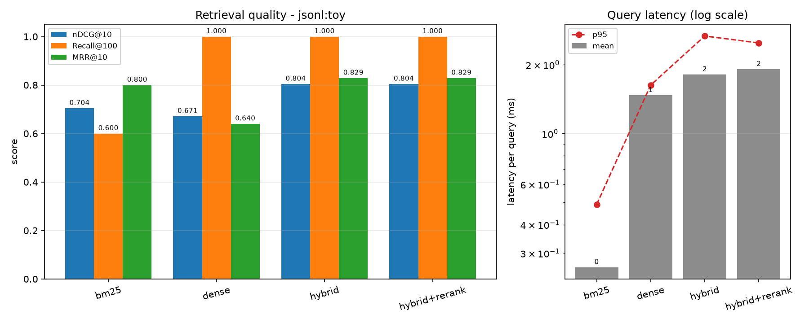

# Results - jsonl:toy

Configuration: `dataset=toy top_k=10 eval_depth=100 chunk=256/32 dense=hashing:sentence-transformers/all-MiniLM-L6-v2 rerank=identity rrf_k=60`

| system | nDCG@10 | Recall@100 | MRR@10 | MAP@100 | mean_latency_ms | p95_latency_ms | index_seconds |
|---|---|---|---|---|---|---|---|
| bm25 | 0.7041 | 0.6000 | 0.8000 | 0.6000 | 0.26 | 0.49 | 0.0 |
| dense | 0.6711 | 1.0000 | 0.6400 | 0.5017 | 1.47 | 1.63 | 0.09 |
| hybrid | 0.8041 | 1.0000 | 0.8286 | 0.6845 | 1.81 | 2.67 | 0.09 |
| hybrid+rerank | 0.8041 | 1.0000 | 0.8286 | 0.6845 | 1.91 | 2.49 | 0.09 |

